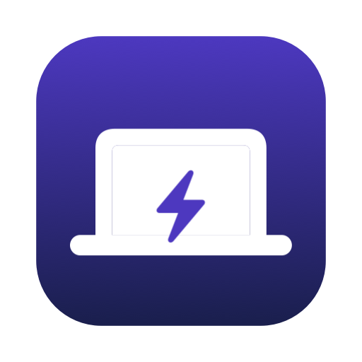

<p align="center">
  
</p>

<h1 align="center">LidAwake</h1>

<p align="center">
  <a href="https://github.com/habibtalib/lidawake/actions/workflows/ci.yml"></a>
  
  
  
  
  <a href="LICENSE"></a>
</p>

<p align="center">
  <b>Keep your MacBook awake with the lid closed.</b><br>
  A menu bar switch, a desktop widget, a CLI and an MCP server for <code>sudo pmset -a disablesleep 1</code>,<br>
  with an auto-off timer and a battery guard so you never forget it on.
</p>

<p align="center">
  <a href="#-install">Install</a> ·
  <a href="#-features">Features</a> ·
  <a href="#-desktop-widget">Widget</a> ·
  <a href="#-cli">CLI</a> ·
  <a href="#-mcp-server">MCP</a> ·
  <a href="#-security">Security</a>
</p>

---

## 💡 Why

Closing a MacBook's lid puts it to sleep, unless an external display, keyboard and power are all connected. That kills SSH sessions, long builds, downloads, agent runs and music over AirPlay.

`sudo pmset -a disablesleep 1` stops that, but it needs a password every time, it is easy to forget, and a Mac left awake in a bag gets hot and drains the battery. LidAwake turns it into a one-click switch that turns itself off.

## ✨ Features

- **Menu bar switch.** One click on, one click off. The icon shows the state and the time left.
- **Timer.** Keep awake for 30 minutes, 1, 2 or 4 hours, or until you turn it off.
- **Battery guard.** Sleep comes back on automatically when you are on battery at 10, 20 or 30% or below.
- **Desktop widget.** Small and medium sizes with interactive buttons (macOS 14+).
- **CLI.** `lidawake on --for 2h`, `lidawake off`, `lidawake status --json`.
- **MCP server.** Lets Claude Code and other agents keep the Mac awake for long tasks, then switch it back.
- **No password prompts.** One admin prompt installs a sudoers rule that allows only `pmset -a disablesleep 1` and `0`.
- **Safe quit.** Quitting while awake asks whether to turn sleep back on.
- **Zero dependencies.** Swift, SwiftUI, WidgetKit and IOKit only.

## 📦 Install

Requires macOS 14 or later and the Xcode command line tools.

```bash
git clone https://github.com/habibtalib/lidawake.git
cd lidawake
Scripts/bundle-app.sh --install     # ~/Applications/LidAwake.app + ~/.local/bin/{lidawake,lidawake-mcp}
lidawake install-permission         # one admin prompt
open ~/Applications/LidAwake.app
```

Or click **Install Permission** in the menu bar panel instead of running `lidawake install-permission`. Turn on **Launch at login** in Settings so the timer and battery guard keep working after a restart.

<details>
<summary><b>Build with the desktop widget</b></summary>

Widgets need a team-signed app with an App Group. A free Personal Team works.

```bash
brew install xcodegen
LIDAWAKE_TEAM=<your team ID> Scripts/build-widgets.sh --install
```

Find your team ID in Xcode > Settings > Accounts. Then right-click the desktop > Edit Widgets > LidAwake.
</details>

## ⚙️ How it works

| Piece | What it does |
|---|---|
| `pmset -g` | Read the current `SleepDisabled` value. No root needed. |
| `/etc/sudoers.d/lidawake` | Lets your user run exactly `/usr/bin/pmset -a disablesleep 1` and `0` without a password. Validated with `visudo` before install. |
| `~/Library/Application Support/LidAwake/session.json` | The current session: when it started, the deadline, the battery floor and what started it. |
| Menu bar app | Checks every 30 seconds and on every power-source change. Turns sleep back on when the timer ends or the battery floor is reached, and posts a notification. |

The CLI and MCP server switch pmset directly. The timer and battery guard need the menu bar app running, or `lidawake on --for 2h --wait` in a terminal.

## 🧩 Desktop widget

The widget shows the state, a live countdown and the battery level. **Turn On / Turn Off** and the **30m / 1h / 2h** buttons work in place.

Widgets are sandboxed and cannot run `sudo`. A tap writes a small request to the shared App Group container and sends a Darwin notification. The menu bar app carries it out and refreshes the widget. If the app is not running, the widget shows **Open LidAwake**.

## ⌨️ CLI

```text
lidawake on [--for <duration>] [--battery-floor <percent>] [--wait]
lidawake off
lidawake toggle
lidawake status [--json]
lidawake install-permission
lidawake uninstall-permission
lidawake version
```

```bash
lidawake on --for 1h30m --battery-floor 20
lidawake status
# ON: the Mac stays awake with the lid closed (1h 29m left).
# Turns off on battery at 20% or lower.
# Started from: cli.
# Battery: 64% (on battery).
```

## 🤖 MCP server

```bash
claude mcp add lidawake -s user -- $HOME/.local/bin/lidawake-mcp
```

| Tool | Arguments |
|---|---|
| `lidawake_status` | none |
| `lidawake_on` | `minutes?`, `battery_floor?` |
| `lidawake_off` | none |

Example: *"Keep the Mac awake for 2 hours while you run the migration, then turn it off."*

## 🔒 Security

- The only command that runs as root is `/usr/bin/pmset -a disablesleep 1` or `0`. The sudoers rule names the full path and both exact argument lists, so no other arguments are allowed.
- The rule is written for your user only, and only after the user name passes a strict character check.
- The rule is checked with `visudo -c` before it is installed with mode `0440`, owner `root:wheel`.
- Remove it at any time: `lidawake uninstall-permission`, or delete `/etc/sudoers.d/lidawake`.

> **Heat warning:** a Mac running with the lid closed on battery, inside a bag or sleeve, can overheat. Use the battery guard and a timer.

## 🛠 Development

```bash
swift build
swift test
swift run LidAwakeApp
```

See [CONTRIBUTING.md](CONTRIBUTING.md).

## 📄 License

[MIT](LICENSE) © 2026 Habib Talib
